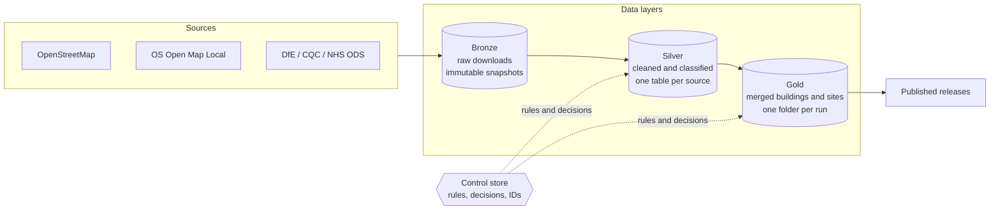

# Critical Buildings

Builds a **critical buildings dataset** for England by combining open map data (OpenStreetMap and Ordnance Survey) with
authoritative registers (DfE schools, CQC care and health, NHS organisations). Every building gets a type (fire station,
hospital, primary school ...), an operational importance, the site it belongs to, a role within that site, and a data
quality score. Every number can be traced back to its source and to the rules that produced it.

The pilot area is **Suffolk** (about 3,500 buildings in about 1,100 sites). More areas are a config file away
(see [adding an area](docs/guide.md#adding-an-area-or-a-source)).

## What you get

Each run writes a folder with these files (a *release* is a permanent copy of one run):

| File | What it is |
|---|---|
| `report.xlsx` | **Start here.** One workbook: a *Summary* sheet (one row per building, 17 easy columns), QA sheets (coverage by type, review queue, sites no register recognises, changes since the last run) and the data dictionary (what every column means, the quality score formula, sources, licences, known limitations). |
| `dataset.gpkg` | The full dataset for GIS tools: layer `buildings` (one row per building, 74 columns) and layer `sites` (one row per site with its outline). |
| `buildings.csv`, `sites.csv` | The same two tables as CSV for everyone else. |
| `ATTRIBUTION.txt` | The credit lines to include when you share the data. |
| `lineage.json` | Exactly what produced this run: input files (checksums), rule version, settings, code version. |

The interactive QA map is no longer stored with every run: draw it from the **Data** tab of the UI when you want it.

## How it works



1. **Bronze** keeps every download exactly as received, dated, with a checksum.
2. **Silver** cleans each source and applies the **rules** (what counts as a fire station, how important it is).
3. **Gold** merges OS and OSM into one record per building, groups buildings into sites, checks them against the registers,
   gives them stable IDs, labels each building's role, and scores data quality.
4. **Releases** are immutable copies of a run that you share.

The **rules and human decisions** live in a small database (`governed/control.db`) with an editor UI, an audit trail and
numbered versions, not in code. Details: [docs/guide.md](docs/guide.md).

## Quick start

Requires Python 3.11+ (developed on 3.14). From the repository folder:

```bash
python -m venv .venv
.venv\Scripts\activate            # macOS/Linux: source .venv/bin/activate
pip install -e ".[ui,dev]"

python -m critical_buildings fetch      # download the source data (about 300 MB) - first time only
python -m critical_buildings check      # confirms rules, settings and data are ready
python -m critical_buildings run        # build the dataset (about a minute after the first run)
python -m critical_buildings runs       # list runs
```

The output is in `data/gold/suffolk/<run id>/`. The `data/` folder is not in git (it is large and regenerable).

## Everyday workflows

**Open the UI** (everyone):

```bash
python -m critical_buildings ui         # opens in your browser
```

| Tab | For |
|---|---|
| **Pipeline** | The pipeline drawn as a graph: sources, stages, releases, coloured by what the latest run did, with source freshness and each stage's counts and steps. |
| **Run** | Fetch, build and release with live progress: which stage and step it is on, counts so far, warnings. A build keeps running if you reload the page. |
| **Runs** | History, size over time, one run in detail (every step with timings), changes against the previous run, archive and tidy up. |
| **Data** | What is on disk in each layer, with previews of any file and an on-demand QA map. |
| **Lineage** | A run's inputs and outputs as a graph, and "why is this record the way it is?". |
| **Quality** | Counts and charts for a run. |
| **Settings** | The technical thresholds in `settings.yml`, edited with a reason. |
| **Reference data** | The business rules, role settings, register mapping and review decisions. Edits go to a draft; *Publish* freezes a numbered version that the next build uses. See [the rules guide](docs/guide.md#rules). |

**Refresh the data** (engineers): `fetch` then `run`. `fetch` only stores a new snapshot if the data changed.

**Review flagged records:** open `report.xlsx` (Review queue, Unverified sites sheets) or the **Review & decisions** tab in
the editor. Decisions are saved against the building and survive reruns.

**Share a version:** `python -m critical_buildings release v2026.10.0 --notes "Suffolk pilot"` copies the run into
`data/published/suffolk/v2026.10.0/` (immutable, checksum-verified).

**Tidy up old data:** `python -m critical_buildings archive` shows what could be archived (dry run);
`archive --apply` does it; `restore` brings something back (the **Runs** tab does the same). Nothing a release depends on is ever touched. See [the run lifecycle](docs/guide.md#runs-releases-and-archiving).


## What is in this repository

```
settings.yml       settings you can tune: thresholds, areas, data sources, the pipeline's stages (one file)
governed/          control.db = the rules store (committed) and control_dump.txt = a text copy so rule changes show in git diffs
src/critical_buildings/   the code: sources.py, silver.py, gold/, publish.py (the layers), progress.py (what a run reports),
                   control/ (rules store), ui/ (the web UI), cli.py
tests/             automated tests (unit + an end-to-end regression against a golden baseline)
docs/              guide.md (how it works, rules, runs, lineage, contributing) and governance.md (roles, checks, licences, decisions)
data/              (not in git)  bronze/ silver/ gold/ published/ archive/ logs/
```

The original Excel rules workbook and the one-off migration scripts were removed from the working tree; they are in git
history at commit `d31315c` (`legacy/`).

## Data sources and licences

OpenStreetMap (ODbL), OS Open Map Local and Code-Point Open (OGL), DfE Get Information About Schools (OGL), CQC (OGL),
NHS Organisation Data Service (OGL). Each release includes the exact attribution text. **OSM data is share-alike
(ODbL): check with your information governance or legal team before distributing the dataset outside your organisation.**

## Status and known limitations

Pilot quality, one area. Importance comes from the rules by building type, not from an assessment of each building.
UPRN counts and the DESNZ/BUUK columns are reserved but not populated. The full list is in the data dictionary
(*Known limitations*) and [docs/governance.md](docs/governance.md#known-limitations-and-roadmap).

## Troubleshooting

- **`check` says there is no bronze data:** run `fetch` first (the data folder is not in git).
- **A permission error on a file in OneDrive:** another program (Excel, QGIS) has it open. Close it, or keep the repository
  outside OneDrive; the data folder and `.venv` sync poorly.
- **Lines like "Can't load requested DLL ... gdalplugins\gdal_*.dll" during a run:** a system-wide GDAL install on your
  PATH is being probed. Harmless; ignore them (or remove the stray GDAL entry from PATH / `GDAL_DRIVER_PATH`).
- **Windows shows "fatal exception" lines in a test run:** harmless DLL-loading noise; tests disable that handler.
- **The UI says nothing is published:** `governed/control.db` is missing or empty: restore it from a backup or from git history.

Contributing: [docs/guide.md](docs/guide.md#contributing).
