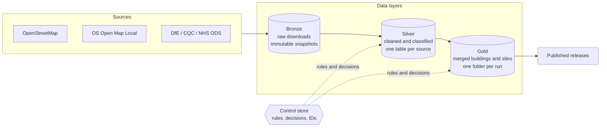

# Critical Buildings

Builds a **critical buildings dataset** for England by combining open map data (OpenStreetMap and Ordnance Survey) with
authoritative registers (DfE schools, CQC care and health, NHS organisations). Every building gets a type (fire station,
hospital, primary school ...), an operational importance, the site it belongs to, a role within that site, and a data
quality score. Every number can be traced back to its source and to the rules that produced it.

The pilot area is **Suffolk** (about 3,500 buildings in about 1,100 sites). More areas are a config file away
(see [adding an area](docs/architecture.md#adding-an-area)).

## What you get

Each run writes a folder with these files (a *release* is a permanent copy of one run):

| File | What it is |
|---|---|
| `critical_buildings_summary.csv` | **Start here.** One row per building, 17 easy columns (type, importance, role, site, verification, quality, lat/lon). |
| `critical_buildings.gpkg` / `.csv` | The full dataset, one row per building (74 columns). GeoPackage for GIS tools, CSV for everything else. |
| `critical_sites.gpkg` / `.csv` | One row per **site** (a school, a hospital, an airfield ...), with the site outline. |
| `critical_buildings_data_dictionary.xlsx` | What every column means, allowed values, the quality score formula, sources and licences, known limitations. |
| `run_summary.xlsx` | QA workbook: coverage by type, items needing review, sites no register recognises, changes since the last run. |
| `qa_map.html` | Interactive map. Open it in a browser. |
| `ATTRIBUTION.txt` | The credit lines to include when you share the data. |
| `lineage.json` | Exactly what produced this run: input files (checksums), rule version, settings, code version. |

## How it works



1. **Bronze** keeps every download exactly as received, dated, with a checksum.
2. **Silver** cleans each source and applies the **rules** (what counts as a fire station, how important it is).
3. **Gold** merges OS and OSM into one record per building, groups buildings into sites, checks them against the registers,
   gives them stable IDs, labels each building's role, and scores data quality.
4. **Releases** are immutable copies of a run that you share.

The **rules and human decisions** live in a small database (`control/control.db`) with an editor UI, an audit trail and
numbered versions, not in code. Details: [docs/architecture.md](docs/architecture.md).

## Quick start

Requires Python 3.11+ (developed on 3.14). From the repository folder:

```bash
python -m venv .venv
.venv\Scripts\activate            # macOS/Linux: source .venv/bin/activate
pip install -e ".[ui,dev]"

python -m critical_buildings fetch      # download the source data (about 300 MB) - first time only
python -m critical_buildings check      # confirms rules, settings and data are ready
python -m critical_buildings run        # build the dataset (about a minute after the first run)
python -m critical_buildings runs       # list runs
```

The output is in `data/gold/suffolk/<run id>/`. The `data/` folder is not in git (it is large and regenerable).

## Everyday workflows

**Change a rule** (analysts) - no code, no Excel needed:

```bash
python -m critical_buildings ui         # opens the rules editor in your browser
```

Edit rules, role settings or the register mapping. The editor checks your edit in plain English, shows what it would
change, and asks for a reason. *Save* writes to a draft; *Publish* freezes it as a numbered version. The next `run` uses it.
See [docs/rules.md](docs/rules.md).

**Refresh the data** (engineers): `fetch` then `run`. `fetch` only stores a new snapshot if the data changed.

**Review flagged records:** open `run_summary.xlsx` (Review queue, Unverified sites) or the **Review & decisions** tab in
the editor. Decisions are saved against the building and survive reruns.

**Share a version:** `python -m critical_buildings release v2026.10.0 --notes "Suffolk pilot"` copies the run into
`published/suffolk/v2026.10.0/` (immutable, checksum-verified).

**Tidy up old data:** `python -m critical_buildings archive` shows what could be archived (dry run);
`archive --apply` does it; `restore` brings something back. Nothing a release depends on is ever touched. See [docs/run-lifecycle.md](docs/run-lifecycle.md).

**Read the rules in Excel:** `python -m critical_buildings export-excel` writes a read-only workbook.

## What is in this repository

```
config/            settings you can tune: pipeline.yml (thresholds), areas/ (one file per area), sources.yml (data sources)
control/           control.db = the rules store (committed), dumps/ = text copies so rule changes show in git diffs
src/critical_buildings/   the code: bronze/ silver/ gold/ publish/ (the layers), control/ (rules store), ui/ (editor), cli.py
tests/             automated tests (unit + an end-to-end regression against a golden baseline)
docs/              architecture, governance, lineage, run lifecycle, rules, decision records
data/              (not in git)  bronze/ silver/ gold/  - the data layers
published/         (not in git)  immutable releases to share
archive/           (not in git)  compressed older data
legacy/            the original Excel workbooks and one-off migration scripts, kept for provenance
```

## Data sources and licences

OpenStreetMap (ODbL), OS Open Map Local and Code-Point Open (OGL), DfE Get Information About Schools (OGL), CQC (OGL),
NHS Organisation Data Service (OGL). Each release includes the exact attribution text. **OSM data is share-alike
(ODbL): check with your information governance or legal team before distributing the dataset outside your organisation.**

## Status and known limitations

Pilot quality, one area. Importance comes from the rules by building type, not from an assessment of each building.
UPRN counts and the DESNZ/BUUK columns are reserved but not populated. The full list is in the data dictionary
(*Known limitations*) and [docs/governance.md](docs/governance.md#known-limitations-and-roadmap).

## Troubleshooting

- **`check` says there is no bronze data:** run `fetch` first (the data folder is not in git).
- **A permission error on a file in OneDrive:** another program (Excel, QGIS) has it open. Close it, or keep the repository
  outside OneDrive; the data folder and `.venv` sync poorly.
- **Windows shows "fatal exception" lines in a test run:** harmless DLL-loading noise; tests disable that handler.
- **The UI says nothing is published:** a fresh store needs a first version: `control init --from-excel <workbook>`.

Contributing: [CONTRIBUTING.md](CONTRIBUTING.md).
