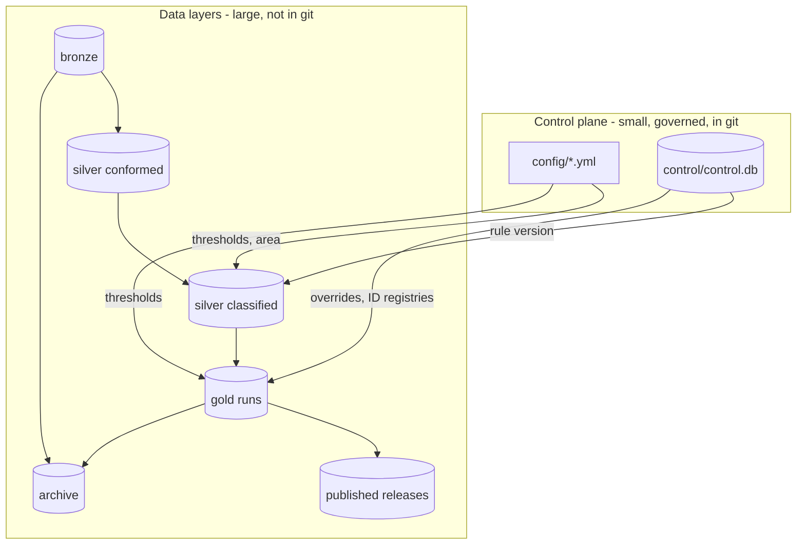

# Architecture

## The layers (medallion)

| Layer | Folder | What is in it | Changes? | Reproducible? |
|---|---|---|---|---|
| **Bronze** | `data/bronze/<source>/<date>/` | Raw downloads exactly as received, plus `_manifest.json` (URL, time, size, SHA-256, licence). `LATEST.json` says which snapshot runs use. | Never edited. New fetch = new folder. | No (it is the evidence) |
| **Silver: conformed** | `data/silver/<area>/conformed/<key>/` | Cleaned tables that do not depend on the rules: CQC locations (parquet), OS building footprints (GeoPackage). `<key>` = hash of the bronze inputs. | Rebuilt when bronze changes. | Yes |
| **Silver: classified** | `data/silver/<area>/classified/<key>/` | OSM and OS features with the rules applied, candidate sites, register records mapped to building types (GeoParquet). `<key>` = hash of bronze + rule version + silver schema. | Cached; same inputs reuse it. | Yes |
| **Gold** | `data/gold/<area>/<run id>/` | One folder per run with every deliverable and `lineage.json`. `CURRENT.json` points at the latest successful run. | Never edited after the run. | Yes |
| **Published** | `published/<area>/<release>/` | A checksum-verified copy of one run, kept permanently. | Immutable. | Yes |

The **control plane** is separate from the data layers: `config/` (settings), `control/control.db` (rules, versions,
audit trail, human decisions, identity registries, run and release registry) and `control/dumps/` (text copies for review).



## What each stage does

| Stage | Code | Input | Output | Checks |
|---|---|---|---|---|
| Fetch | `bronze/` | the internet | new bronze snapshot (only if changed) | checksum, manifest |
| Silver | `silver/` | bronze, rule set | classified OSM/OS features, site polygons, register records | rules check, config check |
| Merge | `gold/merge.py` | classified OSM + OS | one record per building (Both / OSM / OS) | overlap or proximity + same type; ambiguous matches flagged |
| Sites | `gold/sites.py` | merged records, site polygons | `site_group` per building | OS functional site, then OSM site/area, then proximity cluster |
| Register check | `gold/reference_match.py` | sites, DfE/CQC/NHS records | verification, capacity, rating; missing buildings added; type corrections | name + distance + type; location conflicts use the register's postcode |
| IDs and roles | `gold/ids.py`, `gold/roles.py` | records | stable `Building ID` / `Site ID`; Primary / Ancillary / Standalone ... | append-only registries |
| Assemble | `gold/assemble.py`, `gold/overrides.py`, `gold/quality.py` | all of the above, human decisions | the delivered tables, quality score | schema, data dictionary completeness |
| Publish | `publish/` | gold tables | files, QA workbook, map, dictionary, attribution | every output column has a description |

Settings for every threshold are in `config/pipeline.yml` with a comment each; the business rules are in the rules store.

## Design decisions

Short records of why things are the way they are: [docs/decisions/](decisions/).

## Adding an area

1. Copy `config/areas/suffolk.yml`, set the OSM boundary (`ref:gss` code, not just a name) and the OS 100 km grid squares.
2. `python -m critical_buildings fetch --area <name>` then `run --area <name>`.

Registers (DfE, CQC, NHS, Code-Point) are national and shared between areas. Rules are shared too; only the data differs.
(Only Suffolk has been run; other areas are untested.)

## Code map

```
src/critical_buildings/
  cli.py            command line            paths.py     every location in one place
  config.py         settings loader         runs.py      run folders, CURRENT pointer, releases
  retention.py      archive and restore     lineage.py   lineage.json
  bronze/           fetchers, manifests     silver/      conform + classify + register loading
  gold/             merge, sites, register matching, IDs, roles, quality, assembly
  publish/          output files, QA workbook, map, data dictionary
  control/          rules store (SQLite), validation, versions, dumps, Excel view
  matching/         name matching shared by the stages
  ui/               the rules editor (Streamlit)
```
