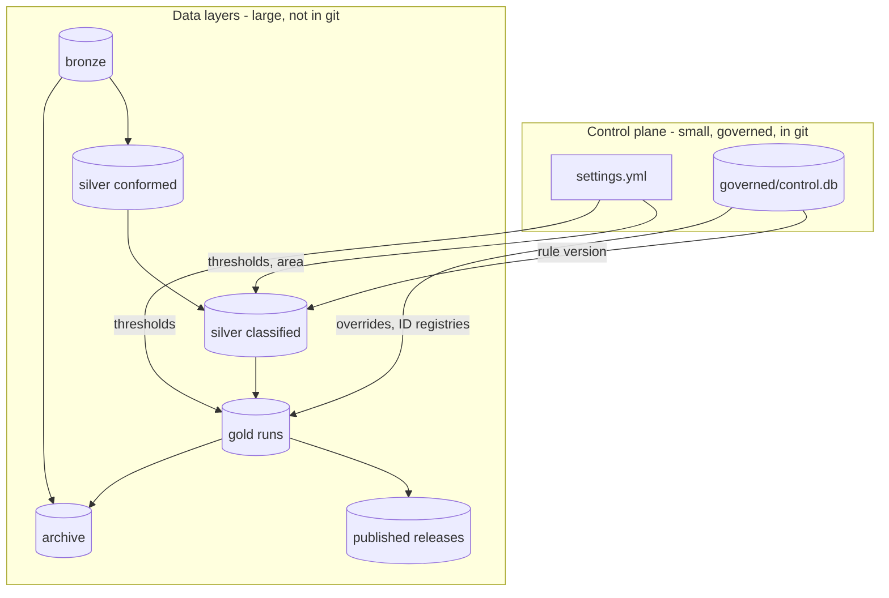
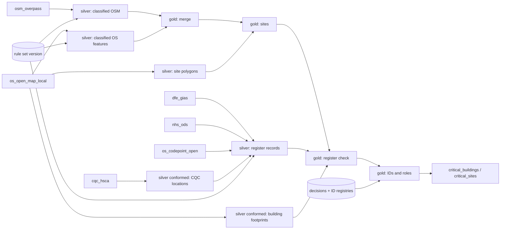

# Guide

How the pipeline is built, how to change the rules, how runs and archives work, how lineage is recorded, and how to
contribute. Ownership, quality checks, licensing and the reasons behind design choices are in [governance.md](governance.md).

Contents: [Layers](#layers) · [Stages and code map](#stages-and-code-map) · [Rules](#rules) · [Runs, releases and archiving](#runs-releases-and-archiving) · [Lineage](#lineage) · [Visual pipelines](#visual-pipelines-duckle) · [Adding an area or a source](#adding-an-area-or-a-source) · [Contributing](#contributing)

## Layers

Everything generated lives under `data/` (git-ignored). Human-governed inputs are `settings.yml` and `governed/`.

| Layer | Folder | What is in it | Changes? | Reproducible? |
|---|---|---|---|---|
| **Bronze** | `data/bronze/<source>/<date>/` | Raw downloads exactly as received, plus `_manifest.json` (URL, time, size, SHA-256, licence). `LATEST.json` says which snapshot runs use. | Never edited. New fetch = new folder. | No (it is the evidence) |
| **Silver: conformed** | `data/silver/<area>/conformed/<key>/` | Cleaned tables that do not depend on the rules: CQC locations (parquet), OS building footprints (GeoPackage). `<key>` = hash of the bronze inputs. | Rebuilt when bronze changes. | Yes |
| **Silver: classified** | `data/silver/<area>/classified/<key>/` | OSM and OS features with the rules applied, candidate sites, register records mapped to building types (GeoParquet). `<key>` = hash of bronze + rule version + silver schema. | Cached; same inputs reuse it. | Yes |
| **Gold** | `data/gold/<area>/<run id>/` | One folder per run with every deliverable and `lineage.json`. `CURRENT.json` points at the latest successful run. | Never edited after the run. | Yes |
| **Published** | `data/published/<area>/<release>/` | A checksum-verified copy of one run, kept permanently. | Immutable. | Yes |
| **Archive** | `data/archive/` | Zipped older gold runs and bronze snapshots (with checksum sidecars). | Written by `archive`. | n/a |

The **control plane** is separate: `settings.yml` (thresholds, areas, source catalogue), `governed/control.db` (rules,
versions, audit trail, human decisions, identity registries, run and release registry) and `governed/dumps/` (text copies for review).



## Stages and code map

| Stage | Code | Input | Output | Checks |
|---|---|---|---|---|
| Fetch | `sources.py` | the internet | new bronze snapshot (only if changed) | checksum, manifest |
| Silver | `silver/` | bronze, rule set | classified OSM/OS features, site polygons, register records | rules check, settings check |
| Merge | `gold/merge.py` | classified OSM + OS | one record per building (Both / OSM / OS) | overlap or proximity + same type; ambiguous matches flagged |
| Sites | `gold/sites.py` | merged records, site polygons | `site_group` per building | OS functional site, then OSM site/area, then proximity cluster |
| Register check | `gold/reference_match.py` | sites, DfE/CQC/NHS records | verification, capacity, rating; missing buildings added; type corrections | name + distance + type; location conflicts use the register's postcode |
| Roles | `gold/roles.py` | records | Primary / Ancillary / Standalone ... | role settings |
| IDs, overrides, quality, assembly | `gold/steps.py` | all of the above, human decisions | stable `Building ID` / `Site ID`, the delivered tables, quality score | append-only registries; schema |
| Publish | `publish.py`, `dictionary.py` | gold tables | files, QA workbook, map, dictionary, attribution | every output column has a description |

```
settings.yml          every threshold, the areas and the source catalogue
governed/             control.db (rules store) + dumps/ (text copies for git review)
data/                 bronze/ silver/ gold/ published/ archive/   (git-ignored)
src/critical_buildings/
  cli.py  paths.py  config.py  pipeline.py  runs.py  retention.py  lineage.py
  sources.py        fetchers, manifests            publish.py + dictionary.py   output files, QA, data dictionary
  silver/           conform + classify + register loading
  gold/             merge (and name matching), sites, reference_match, roles, steps (IDs, overrides, quality, assembly)
  control/          rules store (SQLite), validation, versions, dumps, Excel view
  ui/               the rules editor (Streamlit)
```

## Rules

A **rule** says "buildings recognised by any of its tags are this **building type**". It has:

| Field | Meaning |
|---|---|
| Rule Ref | A number identifying the rule. |
| Primary Category / Building Type | Labels in the output (Emergency / Fire Station). |
| Operational Importance + Driver | High, Medium or Low, with the plain-English reason. |
| Priority | When a feature matches several rules, the **lowest number wins** (50 = normal, 90 = generic fallback). |
| Active | Switch a rule off without deleting it. |

Each rule has one or more **tags**:

| Source | Format | Example |
|---|---|---|
| OSM | `key=value` (no spaces; `key=*` = any value) | `amenity=fire_station` |
| OS | `Theme > Classification` | `Emergency Service > Fire Station` |
| MANUAL | (blank) | Rule 34, "Commercially or Reputationally Important": only ever set by a human decision |

Other governed settings: **role settings** (the footprint size, default 150 m², above which a building at a multi-building
site is *Primary*; OSM `building=` values that are always Ancillary or Primary; optional per-type minimums) and the
**register mapping** (how DfE, CQC and NHS ODS records become building types; first match wins; `IGNORE` drops a record).

**Changing rules:** `python -m critical_buildings ui`.

1. **Rules tab**: edit the rule grid and the tag grid; *Add a new rule*; untick *Active* to stop using one.
2. The **check of your edits** panel explains any problem in plain English and shows what the edit would change.
3. **Save to the draft** (needs your name and a reason).
4. **Publish** in the sidebar. Runs use only published versions.

For a read-only spreadsheet view: `python -m critical_buildings export-excel`.

**Storage.** Rules are in `governed/control.db` (SQLite): `rule`, `rule_tag`, `role_setting`, `role_osm_value`,
`role_type_min`, `reference_mapping`, numbered immutable versions (`rule_set_version`) and the audit trail (`change_log`).
A binary file does not diff in git, so every save and publish rewrites text copies in `governed/dumps/`; review those.
The rules began in an Excel workbook that was imported once; it is in git history (see the README).

## Runs, releases and archiving

Nothing is overwritten. Every layer keeps its history under an identifier.

| Id | Looks like | Means |
|---|---|---|
| `run_id` | `20261001T145935_suffolk` | One execution of the pipeline. |
| `bronze key` | `9db1914296f9` | Hash of the exact bronze files a run read. |
| `silver key` | `1775330ea165` | Hash of bronze key + rule set + silver schema. |
| `release` | `v2026.10.0` | A named, immutable copy of one run. |
| rule `version_id` | `3` (label `v3-a1b2c3`) | A published rule set. |

**What happens when you run again**

- **Bronze.** `fetch` stores a new dated folder only if a checksum changed. Old snapshots stay. A run reads `LATEST.json`.
- **Silver.** Same bronze + rules + schema = same key = the cached build is reused. Change a rule or fetch new data and a fresh build is made; the old one stays.
- **Gold.** Every run creates `data/gold/<area>/<run_id>/`. `CURRENT.json` points at the latest *successful* run; a failed run leaves no partial folder.
- **Previous run.** The new run is compared with the run `CURRENT.json` pointed at when it started; differences (added, removed, reclassified, source changed) are stored in `run_change` and shown in `run_summary.xlsx`. If that folder was archived the run counts as a first run.
- **Identity.** Building and Site IDs live in append-only registries in the control store, so they survive even if every gold folder is archived. IDs are never reused; absent buildings are *retired*, and a returning one gets its old ID.

**Run types:** `run --type dev|candidate` (default `dev`). `dev` is scratch work, first to be pruned; `candidate` may be released.

**Releases:** `python -m critical_buildings release [NAME] [--run RUN_ID] [--notes ...]` copies the run's deliverables and
`lineage.json` to `data/published/<area>/<NAME>/`, verifies every checksum, writes `RELEASE.json` and records it. Names are
never reused (default `vYYYY.MM.n`). A release **protects** its run, the bronze snapshots it read and its silver build.

**Retention:** `archive` (dry run) lists what the policy would do; `--apply` does it. Numbers are in `settings.yml` under `retention`.

| Layer | Kept | Older ones |
|---|---|---|
| bronze | latest 3 snapshots per source, plus `LATEST` | zipped into `data/archive/bronze/...` |
| silver | latest 2 builds per area | deleted (rebuilt from bronze and the rules) |
| gold | latest 5 runs, `CURRENT`, and any dev run younger than 14 days | candidate runs zipped into `data/archive/gold/...`; dev runs deleted |
| published | everything | never touched |

`LATEST`/`CURRENT` and anything a release depends on are never touched. Archives are verified (zip test, SHA-256 sidecar)
before the original is removed. Restore with `restore gold <run_id>` or `restore bronze <source folder>/<snapshot>`.

**Reproducing an old run:** `lineage.json` names the bronze snapshots (with checksums), rule version, settings hash and git
commit. Check out that commit, restore those snapshots, pin the rule version (`run --rules-version N`), and run.

## Lineage

**1. Run lineage: `lineage.json`** (in every run folder and release).

| Section | Contains |
|---|---|
| `run_id`, `area`, `run_type`, times, `tool_version` | which run |
| `git` | commit hash and whether `src/` or `settings.yml` had uncommitted changes (`dirty`) |
| `rules` | rule set version id and label (`v3-a1b2c3`) |
| `config` | hash of the tuning settings and of the area entry |
| `bronze` | per source: snapshot, retrieval time, licence, each file with SHA-256 and size |
| `silver` | the silver build key and whether it was reused |
| `gold` | building and site counts, counts by source and verification, new IDs, previous run id, changes versus previous |
| `outputs` | every delivered file with SHA-256, plus a canonical content hash of the buildings table |

The canonical hash ignores columns that change on every run (dates, rule version) and row order.

**2. Dataset lineage**



**3. Record and column lineage** (inside the data)

| Column | Tells you |
|---|---|
| `Source`, `Source Feature ID` | which dataset(s) and the exact feature ids (OS GUID, OSM `way/123`, `CQC:1-...`, `DfE GIAS:123456`) |
| `Match Method`, `Confidence`, `Review Reason` | how OS and OSM were matched and any doubt |
| `OS Rule Ref`, `OSM Rule Ref`, `All Matched Rule Refs`, `Rule Notes` | which rules fired |
| `Classification Note` | if a register changed the type chosen from OS/OSM |
| `Site ID`, `Site Method` | which site and how it was formed |
| `Building Role Reason` | why a building is Primary or Ancillary |
| `Verification`, `Verification Note`, `Authoritative ID`, `Authoritative Distance (m)` | which register record confirmed it, and how far apart |
| `Review Decision`, `Manual Override Notes`, `*Override` | human decisions |
| `Rule Version`, `Run Date` | the rule version and date of the run |

**"Why is this building like this?"** Find it by `Building ID`; read `Source Feature ID`, `Match Method`, `All Matched Rule
Refs`. `Rule Version` gives the rule set (UI *Versions & history*, or `governed/dumps/rule_tag.csv` in git history). The run's
`lineage.json` gives the input files. `governed/dumps/override.csv` and the audit trail show any manual decision.

## Visual pipelines (Duckle)

`pipelines/*.json` are [Duckle](https://duckle.org) pipelines: open one in the Duckle desktop app to see and edit it as a
canvas (drag nodes, preview each step), or run it headless. They are plain JSON, so changes show in git diffs.
`pip install -e ".[canvas]"` installs the headless runner. Run from the repository folder:

| Pipeline | Does | Run |
|---|---|---|
| `fetch_sources` | `fetch`: new bronze snapshots only if the data changed | `duckle --pipeline pipelines/fetch_sources.json --workspace data/duckle` |
| `build_dataset` | checks, then `run` (silver > gold > publish) as a candidate run | `duckle --pipeline pipelines/build_dataset.json --workspace data/duckle` |
| `review_latest_run` | SQL over the run registry in `governed/control.db`: counts not empty, within 10% of the previous run | `duckle --pipeline pipelines/review_latest_run.json --workspace data/duckle` |
| `release_run` | `release` the current run | `duckle --pipeline pipelines/release_run.json --workspace data/duckle --param RELEASE_NAME=v2026.10.0` |

Exit code 0 = success, 1 = a step or assertion failed. Run receipts and small result files go to `data/duckle/`.

How it fits: the geospatial logic stays in this package and is called by a shell node (`python -m critical_buildings ...`);
Duckle supplies the canvas, run history, parameters and SQL steps. The rules store stays ours (edited in the rules UI) and
Duckle reads it through SQLite. Two things to know: a shell step that fails does not fail the node by itself, so every step is
followed by an assertion on its exit code and a sink (assertions only run when something downstream consumes them); and
order is only guaranteed along edges that carry data, so the check and the build are one step. Duckle is version 0.x, so
the extra pins it below 0.8.

## Adding an area or a source

**Area:** add an entry under `areas:` in `settings.yml` (the OSM boundary by `ref:gss` code, not just a name, and the OS 100 km
grid squares), then `fetch --area <name>` and `run --area <name>`. Registers are national and shared; rules are shared;
only the data differs. (Only Suffolk has been run.)

**Source:** add it under `sources:` in `settings.yml` (licence and attribution are copied into manifests and
`ATTRIBUTION.txt`), write a `fetch_<name>` function in `sources.py`, read it in `silver/`, and add tests (see
`tests/test_bronze.py` for serving files from a local web server).

## Contributing

```bash
python -m venv .venv
.venv\Scripts\activate
pip install -e ".[ui,dev]"
python -m pytest -m "not slow"      # fast tests (seconds)
python -m pytest                    # everything, including the end-to-end regression (needs data/; about 4 min)
```

- **Behaviour changes need a reason.** `tests/test_e2e_regression.py` reproduces `tests/golden/baseline.json`. If you change
  the matching logic or thresholds on purpose, review the differences, regenerate with
  `python tests/golden_utils.py <run folder> tests/golden/baseline.json`, and say why in the commit message.
- **Settings, not magic numbers.** Thresholds belong in `settings.yml` with a comment. Business rules belong in the rules store.
- **Paths come from `paths.py`.** Do not build paths from `__file__`.
- **SQL only in `control/store.py`.** Everything else uses its methods.
- **A new output column needs a description** in `dictionary.py`, or the run stops.
- **Rule changes:** use the UI, then commit `governed/control.db` and the updated `governed/dumps/` (do not edit dumps by hand).
  Do not commit `data/` or `.venv/`.
- Small commits with a message that says *why*; keep the golden regression green.
