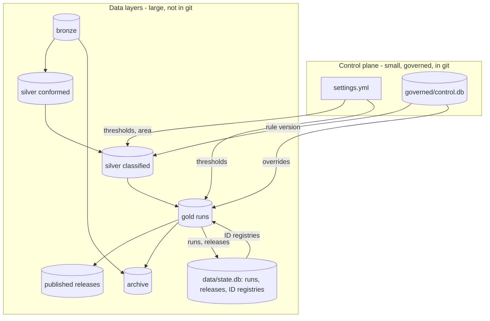
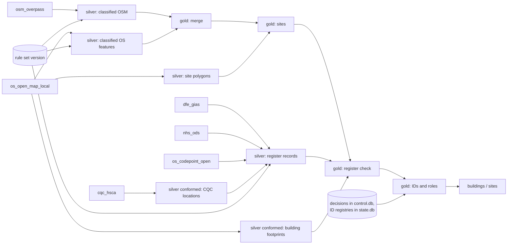

# Guide

How the pipeline is built, how to change the rules, how runs and archives work, how lineage is recorded, and how to
contribute. Ownership, quality checks, licensing and the reasons behind design choices are in [governance.md](governance.md).

Contents: [Layers](#layers) · [Stages and code map](#stages-and-code-map) · [Rules](#rules) · [Runs, releases and archiving](#runs-releases-and-archiving) · [Lineage](#lineage) · [The UPRN property table](#the-uprn-property-table) · [Linking sites to other data](#linking-sites-to-other-data-uprns-and-postcodes) · [Adding an area or a source](#adding-an-area-or-a-source) · [Contributing](#contributing)

## Layers

Everything generated lives under `data/` (git-ignored). Human-governed inputs are `settings.yml` and `governed/`.

| Layer | Folder | What is in it | Changes? | Reproducible? |
|---|---|---|---|---|
| **Bronze** | `data/bronze/<source>/<date>/` | Raw downloads exactly as received, plus `_manifest.json` (URL, time, size, SHA-256, licence). `LATEST.json` says which snapshot runs use. | Never edited. New fetch = new folder. | No (it is the evidence) |
| **Silver: conformed** | `data/silver/<area>/conformed/<key>/` | Cleaned tables that do not depend on the rules: CQC locations (parquet), OS building footprints (GeoPackage). `<key>` = hash of the bronze inputs; a table is copied forward from an earlier build when the sources it reads are unchanged (an OSM refresh does not re-read the CQC spreadsheet). | Rebuilt when its sources change. | Yes |
| **Silver: classified** | `data/silver/<area>/classified/<key>/` | OSM and OS features with the rules applied, candidate sites, register records mapped to building types (GeoParquet). `<key>` = hash of bronze + rule version + area settings + silver code + silver schema. | Cached; same inputs reuse it. | Yes |
| **Gold** | `data/gold/<area>/<run id>/` | One folder per run with every deliverable and `lineage.json`. `CURRENT.json` points at the latest successful run. | Never edited after the run. | Yes |
| **Published** | `data/published/<area>/<release>/` | A checksum-verified copy of one run, kept permanently. | Immutable. | Yes |
| **Archive** | `data/archive/` | Zipped older gold runs and bronze snapshots (with checksum sidecars). | Written by `archive`. | n/a |
| **Logs** | `data/logs/` | One `<run id>.jsonl` per run (every stage, step and count, kept even if the run failed) and the output of jobs started from the UI. | Appended during a run. | n/a |

The **control plane** is separate: `settings.yml` (thresholds, areas, source catalogue), `governed/control.db` (rules,
versions, audit trail and human decisions) and `governed/control_dump.txt` (a text copy for review). What the pipeline *does* is
recorded apart from that, in `data/state.db` (not in git): the run and release registry, per-stage timings and counts, per-run changes and the
append-only Building and Site ID registries. A build only ever writes to `state.db`, so the committed rules store changes only when someone edits rules.



## Stages and code map

| Stage | Code | Input | Output | Checks |
|---|---|---|---|---|
| Fetch | `sources.py` | the internet | new bronze snapshot (only if changed) | checksum, manifest |
| Silver | `silver.py` | bronze, rule set | classified OSM/OS features, site polygons, register records | rules check, settings check |
| Merge | `gold/merge.py` | classified OSM + OS | one record per building (Both / OSM / OS) | overlap or proximity + same type; ambiguous matches flagged |
| Sites | `gold/sites.py` | merged records, site polygons | `site_group` per building | OS functional site, then OSM site/area, then proximity cluster |
| Register check | `gold/reference_match.py` | sites, DfE/CQC/NHS records | verification, capacity, rating; missing buildings added; type corrections | name + distance + type; location conflicts use the register's postcode |
| Roles | `gold/roles.py` | records | Primary / Ancillary / Standalone ... | role settings |
| IDs, overrides, quality, assembly | `gold/steps.py` | all of the above, human decisions | stable `Building ID` / `Site ID`, the delivered tables, quality score | append-only registries; schema |
| Publish | `publish.py`, `dictionary.py` | gold tables | `dataset.gpkg`, CSVs, `report.xlsx` (summary, QA, dictionary), attribution | every output column has a description |

```
settings.yml          every threshold, the areas and the source catalogue
governed/             control.db (rules store) + control_dump.txt (text copy for git review)
data/                 bronze/ silver/ gold/ published/ archive/   (git-ignored)
src/critical_buildings/
  cli.py  paths.py  config.py  pipeline.py  runs.py  retention.py  lineage.py
  sources.py        fetchers, manifests            publish.py + dictionary.py   output files, QA, data dictionary
  silver.py         conform + classify + register loading
  progress.py       what a run reports: stages, steps, counts (feeds the UI and the run registry)
  gold/             merge (and name matching), sites, reference_match, roles, steps (IDs, overrides, quality, assembly)
  control/          rules store (SQLite), rule set and checks (rules.py), text dump
  ui/               the rules editor (Streamlit)
  properties/       the UPRN property table (its own command; see below)
  areas.py  postcodes.py   the area outline and Code-Point postcodes, shared
```

### One repository, several products: what depends on what

The repo holds more than one data product: the critical-buildings dataset (`silver.py`, `gold/`, `publish.py`, `runs.py`, `control/`, `ui/`
and the rest of the pipeline) and the UPRN property table (`properties/`). They share a small **core**:

| Shared core | What it is |
|---|---|
| `sources.py`, `source_checks.py` | the source catalogue, fetching, bronze snapshots and checks that a file still has the layout the readers expect |
| `paths.py`, `config.py` | every location, run folders and the output-file finder, and `settings.yml` |
| `locks.py`, `lineage.py`, `progress.py`, `errors.py` | the one-operation-at-a-time lock, lineage records, progress reporting, plain-English errors |
| `areas.py`, `postcodes.py` | an area's outline and the Code-Point postcodes |

**The rule:** a product may import the shared core but nothing from another product, and the core imports no product. `tests/test_architecture.py`
checks it on every run (and names the file and module when it is broken). The one exception on record is `sources.py`, which builds the
OpenStreetMap query from the critical-buildings rule tags. The point is that moving a product to its own repository later is then a small job:
copy its folder, install the core as a package, and replace what it reads from the other product (the property table reads critical sites from
the critical-buildings run folder) with a released dataset. Until then it is one repository, which keeps one source catalogue, one set of
downloads and one place for licences.

## Rules

A **rule** says "buildings recognised by any of its tags are this **building type**". It has:

| Field | Meaning |
|---|---|
| Rule Ref | A number identifying the rule. |
| Primary Category / Building Type | Labels in the output (Emergency / Fire Station). |
| Operational Importance + Driver | High, Medium or Low, with the plain-English reason. |
| Priority | When a feature matches several rules, the **lowest number wins** (50 = normal, 90 = generic fallback). |
| Active | Switch a rule off without deleting it. |

Each rule has one or more **tags**:

| Source | Format | Example |
|---|---|---|
| OSM | `key=value` (no spaces; `key=*` = any value) | `amenity=fire_station` |
| OS | `Theme > Classification` | `Emergency Service > Fire Station` |
| MANUAL | (blank) | Rule 34, "Commercially or Reputationally Important": only ever set by a human decision |

Other governed settings: **role settings** (the footprint size, default 150 m², above which a building at a multi-building
site is *Primary*; OSM `building=` values that are always Ancillary or Primary; optional per-type minimums) and the
**register mapping** (how DfE, CQC and NHS ODS records become building types; first match wins; `IGNORE` drops a record).

**Changing rules:** `python -m critical_buildings ui`.

1. **Rules tab**: edit the rule grid and the tag grid; *Add a new rule*; untick *Active* to stop using one.
2. The **check of your edits** panel explains any problem in plain English and shows what the edit would change.
3. **Save to the draft** (needs your name and a reason).
4. **Publish** in the sidebar. Runs use only published versions.


**Storage.** Rules are in `governed/control.db` (SQLite): `rule`, `rule_tag`, `role_setting`, `role_osm_value`,
`role_type_min`, `reference_mapping`, numbered immutable versions (`rule_set_version`) and the audit trail (`change_log`).
A binary file does not diff in git, so every save and publish rewrites one text copy, `governed/control_dump.txt`; review that.
Runs, releases and the ID registries are not here: they are in `data/state.db` (tables `run`, `run_stage`, `run_change`, `release`,
`building_registry`, `site_registry`). An older `control.db` that still holds them is upgraded the first time it is opened: the rows are copied to
`state.db` and the old tables are dropped.
The rules began in an Excel workbook that was imported once; it is in git history (see the README).

## Runs, releases and archiving

Nothing is overwritten. Every layer keeps its history under an identifier.

| Id | Looks like | Means |
|---|---|---|
| `run_id` | `20261001T145935_suffolk` | One execution of the pipeline. |
| `bronze key` | `9db1914296f9` | Hash of the exact bronze files a run read. |
| `silver key` | `1775330ea165` | Hash of bronze key + rule set + area settings + silver code + silver schema. |
| `release` | `v2026.10.0` | A named, immutable copy of one run. |
| rule `version_id` | `3` (label `v3-a1b2c3`) | A published rule set. |

**What happens when you run again**

- **Bronze.** `fetch` stores a new dated folder only if a checksum changed. Old snapshots stay. A run reads `LATEST.json`.
- **Silver.** Same bronze + rules + schema = same key = the cached build is reused. Change a rule or fetch new data and a fresh build is made; the old one stays.
- **Gold.** Every run creates `data/gold/<area>/<run_id>/`. `CURRENT.json` points at the latest *successful* run; a failed run leaves no partial folder.
- **Previous run.** The new run is compared with the run `CURRENT.json` pointed at when it started; differences (added, removed, reclassified, source changed) are stored in `run_change` and shown in `run_summary.xlsx`. If that folder was archived the run counts as a first run.
- **Identity.** Building and Site IDs live in append-only registries in `data/state.db`, so they survive even if every gold folder is archived. The file is not in git, and without it a new build mints fresh IDs, so every successful run and every release copies it to `data/backups/` (newest 10 run backups, plus one per release kept for good; `backup` does it on demand). Keep that folder somewhere safe. IDs are never reused; absent buildings are *retired*, and a returning one gets its old ID.

**Run types:** `run --type dev|candidate` (default `dev`). `dev` is scratch work, first to be pruned; `candidate` may be released.

**Releases:** `python -m critical_buildings release [NAME] [--run RUN_ID] [--notes ...]` copies the run's deliverables and
`lineage.json` to `data/published/<area>/<NAME>/`, verifies every checksum, writes `RELEASE.json` and records it. Names are
never reused (default `vYYYY.MM.n`). A release **protects** its run, the bronze snapshots it read and its silver build.

**Retention:** `archive` (dry run) lists what the policy would do; `--apply` does it. Numbers are in `settings.yml` under `retention`.

| Layer | Kept | Older ones |
|---|---|---|
| bronze | latest 3 snapshots per source, plus `LATEST` | zipped into `data/archive/bronze/...` |
| silver | latest 2 builds per area | deleted (rebuilt from bronze and the rules) |
| gold | latest 5 runs, `CURRENT`, and any dev run younger than 14 days | candidate runs zipped into `data/archive/gold/...`; dev runs deleted |
| published | everything | never touched |

`LATEST`/`CURRENT` and anything a release depends on are never touched. Archives are verified (zip test, SHA-256 sidecar)
before the original is removed. Restore with `restore gold <run_id>` or `restore bronze <source folder>/<snapshot>`.

**Reproducing an old run:** `lineage.json` names the bronze snapshots (with checksums), rule version, settings hash and git
commit. Check out that commit, restore those snapshots, pin the rule version (`run --rules-version N`), and run.

## Lineage

**1. Run lineage: `lineage.json`** (in every run folder and release).

| Section | Contains |
|---|---|
| `run_id`, `area`, `run_type`, times, `tool_version` | which run |
| `git` | commit hash and whether `src/` or `settings.yml` had uncommitted changes (`dirty`) |
| `rules` | rule set version id and label (`v3-a1b2c3`) |
| `config` | hash of the tuning settings and of the area entry |
| `bronze` | per source: snapshot, retrieval time, licence, each file with SHA-256 and size |
| `silver` | the silver build key and whether it was reused |
| `gold` | building and site counts, counts by source and verification, new IDs, previous run id, changes versus previous |
| `outputs` | every delivered file with SHA-256, plus a canonical content hash of the buildings table |

The canonical hash ignores columns that change on every run (dates, rule version) and row order.

**2. Dataset lineage**



**3. Record and column lineage** (inside the data)

| Column | Tells you |
|---|---|
| `Source`, `Source Feature ID` | which dataset(s) and the exact feature ids (OS GUID, OSM `way/123`, `CQC:1-...`, `DfE GIAS:123456`) |
| `Match Method`, `Confidence`, `Review Reason` | how OS and OSM were matched and any doubt |
| `OS Rule Ref`, `OSM Rule Ref`, `All Matched Rule Refs`, `Rule Notes` | which rules fired |
| `Classification Note` | if a register changed the type chosen from OS/OSM |
| `Site ID`, `Site Method` | which site and how it was formed |
| `Building Role Reason` | why a building is Primary or Ancillary |
| `Verification`, `Verification Note`, `Authoritative ID`, `Authoritative Distance (m)` | which register record confirmed it, and how far apart |
| `Review Decision`, `Manual Override Notes`, `*Override` | human decisions |
| `Rule Version`, `Run Date` | the rule version and date of the run |

**"Why is this building like this?"** Find it by `Building ID`; read `Source Feature ID`, `Match Method`, `All Matched Rule
Refs`. `Rule Version` gives the rule set (UI *Versions & history*, or `governed/control_dump.txt` in git history). The run's
`lineage.json` gives the input files. the `override` section of `governed/control_dump.txt` and the audit trail show any manual decision.

## Running from the UI

`python -m critical_buildings ui` opens the web UI. The **Run** tab shows what a build would do (rule set, whether the cleaned
data can be reused, whether the sources changed) and has **Fetch**, **Build** (dev or candidate, with notes) and **Release**
buttons. A job runs in a separate process, so reloading the page or closing the tab does not stop it. While it runs the page
shows each stage (clean and classify, match and identify, write deliverables), the step it is on, counts so far and warnings;
the same events are kept in `data/logs/<run id>.jsonl` and in the run registry (`run_stage`), so **Runs** can show a finished run's
timeline later. If the process dies (PC asleep, window closed) the run is marked failed and its half-written folder removed.

**How a stage reports.** Code calls `progress.step("...")`, `progress.note("name", value)` and `progress.bar(done, total)` inside
`with progress.stage("gold"):`. The stages themselves are listed under `pipeline.stages` in `settings.yml` (id, label, layer,
description, and the function that runs them), which is also what the **Pipeline** tab draws, so a new stage appears in the UI
once it is declared there.

The other tabs: **Pipeline** (the graph with source freshness and per-stage detail), **Runs** (history, size over time, changes,
archive), **Data** (browse and preview every layer), **Lineage** (inputs to outputs, and why a record is as it is), **Quality**
(charts), **Settings** (thresholds with a reason) and **Reference data** (the editable rules).

**What a run folder holds** (`data/gold/<area>/<run id>/`): `dataset.gpkg` (layers `buildings`, `sites`), `buildings.csv`,
`sites.csv`, `site_uprns.csv`, `report.xlsx` (Summary sheet first, then QA sheets, then the data dictionary), `ATTRIBUTION.txt`, `lineage.json`.
Runs made before this layout used longer names (`critical_buildings.csv`, `critical_sites.csv`, separate workbooks and a stored
map); they are still read and released as they are.

## The UPRN property table

A second product, built from the same data and the same pipeline code. It answers "what do we know about this address point?" for every
UPRN (an addressable location: a house, a flat, a shop, a bus shelter) in an area, using only open data.

```bash
python -m critical_buildings fetch --only properties     # about 2.4 GB, once: census areas, deprivation, planning layers, flood zones
python -m critical_buildings properties --check          # says whether everything it needs has been fetched
python -m critical_buildings properties --area suffolk   # about a minute for Suffolk's 548,000 UPRNs
python -m critical_buildings properties --area england   # about 30 minutes for England's 35.7 million UPRNs (needs about 10 GB of memory)
```

In the web UI the property table has its own app, `python -m critical_buildings properties-ui` (port 8502, separate from the
critical-buildings app on 8501, so the two pipelines are never mixed up). It does all of this without the command line: it fetches the property sources and builds the table as
background jobs, says when a newer critical-buildings run or source snapshot makes the table out of date, shows what each link covers, and
explores the table (district, flood zone, deprivation, planning status, nearest critical site) with a map and a CSV download of up to
200,000 rows. It reads the parquet through pyarrow, so it stays quick for England.

Output (not in git): `data/properties/<area>/<run id>/table/` (parquet, one folder per 100 km OS grid square), beside `columns.csv` (what
every column means), `ATTRIBUTION.txt` (credits to include when you share it), `summary.json` (how many rows have each link) and
`lineage.json` (what went in). Read it with any parquet reader:

```python
import pandas as pd
df = pd.read_parquet("data/properties/suffolk/<run id>/table")           # QGIS, DuckDB and R read the folder too
df[(df.flood_zone == 3) & (df.imd_decile <= 3)]                          # high flood risk in the most deprived 30% of areas
```

| Link | Where it comes from | Columns |
|---|---|---|
| The UPRN and its position | OS Open UPRN (OGL) | `uprn`, `easting`, `northing`, `latitude`, `longitude`, `os_tile` |
| Building | OS Open Map Local building footprints: the one the point lies inside | `building_id`, `building_area_m2`, `uprns_in_building` (1 suggests a house, many suggest flats) |
| Postcode | The nearest Code-Point Open postcode point within 250 m | `postcode`, `postcode_distance_m` |
| Census area and deprivation | ONS LSOA outlines (2021) and the English Indices of Deprivation 2025 | `lsoa_*`, `lad_*`, `imd_score`, `imd_rank`, `imd_decile`, seven domain deciles, children and older-people indices, LSOA population (total, aged 0-15, aged 60 and over) |
| Planning | planning.data.gov.uk: conservation areas, Article 4 direction areas, Historic England listed building outlines and points | `conservation_area`(`_name`), `article_4_area`, `listed_in_outline`, `listed_grade`, `listed_distance_m` |
| Flood | Environment Agency Flood Map for Planning, zones 2 and 3 (rivers and sea) | `flood_zone` (3 high, 2 medium, 1 low), `flood_zone_type` |
| Critical sites | The area's current critical-buildings run | `critical_site_id`, `_type`, `_importance`, `_distance_m` (0 = inside the site outline; otherwise the nearest within 1 km) |

What to know before relying on it:

- **It is every address point, not every home.** OS Open UPRN does not say which are domestic. The clearest open signal for "domestic" is the
  EPC register (also the source of age, built form, floor area and heating), which needs a free account to download, so it is not
  included yet. Until then `uprns_in_building` and the building area are the only hints.
- **Deprivation is a property of the area, not the household:** every UPRN in an LSOA gets the LSOA's scores.
- **The postcode is a guide.** The nearest postcode centre is often a neighbouring postcode, and 5% of Suffolk's UPRNs have none within 250 m.
- **Listed status is approximate.** Where Historic England publishes an outline (about 3,000 in Suffolk) `listed_in_outline` is the sure case.
  The grade comes from the nearest listing point within 10 m, which is rough (measured: for UPRNs inside an outline, three in four have a
  point within 11 m); it can name a neighbour and miss a listing whose point is further off.
- **Flood zones ignore flood defences and cover rivers and the sea only**, not surface water or groundwater. Zone 1 means "not in zone 2 or 3",
  not "no risk". Surface water mapping is not offered because the Environment Agency says its dataset is not for property-level use, and
  the British Geological Survey's groundwater data is licensed, not open.
- **Planning layers are only as complete as the councils that publish them** on planning.data.gov.uk. `article_4_area` says a point is
  inside at least one Article 4 direction area, not which rights it withdraws (a council may publish a borough-wide direction, which
  puts every UPRN in the borough in the area: in England 16% of UPRNs are, and Westminster, Barnet, Oxford and Southampton are 100%).
- **`flood_zone_type` is the source's own wording** (about 30 variants such as "Fluvial Models" or "Tidal Models and Tidal Events").
- **The critical_site columns need a current critical-buildings run** for the area (`run --area <area>`); without one they are empty.
- **Not yet part of the release system:** a property table has its own folder and lineage, but is not in the run registry, retention
  or the UI, and it has no releases.

**Checked.** Suffolk: the five districts hold all but 54 of 547,714 UPRNs (those sit on the county edge), and spot checks matched the real
world (Ipswich Cornhill and Lavenham in their conservation areas, the Ipswich Wet Dock marina in flood zone 3 from tidal models).
England (35,704,860 UPRNs, 1.6 GB, 27 grid squares): exactly the 296 English local authorities; every deprivation decile holds 8 to 11% of
UPRNs (it should be 10%); the districts with the most UPRNs in flood zone 3 are the known ones (Boston 94%, Hull 90%, South Holland 77%,
East Lindsey 50%; Southwark and Hammersmith and Fulham are above 60% because the Thames floodplain is mapped without its defences); and the
779,395 UPRNs inside a critical site equal the distinct UPRNs of `site_uprns.csv`, which a different piece of code produced. 85% of UPRNs are
inside a building footprint, 97% have a postcode within 250 m, 100% have an LSOA and deprivation scores.
**How it scales:** memory is bounded by the largest grid square (TQ, around London, has 8.2 million UPRNs and takes about 10 GB), and the
flood zones are cached one folder per square under `data/silver/<area>/properties/`. **How it stays fast:** each 100 km square is linked on its own; the point-in-polygon test finds bounding-box candidates and tests
exact pairs with prepared polygons (the index's one-step predicate took 47 s per 100,000 points against the flood outlines, which have up to
250,000 vertices; this takes a fraction of a second).

## Linking sites to other data (UPRNs and postcodes)

To see which critical sites a utility network (or any customer or asset data) serves, join on the keys the sites carry. Three files
help, all written by the gold stage against the final site outlines:

| Where | What |
|---|---|
| `site_uprns.csv` | One row per site and UPRN: every OS Open UPRN point inside (or on) the site outline. **The exact join table**: join your customers or supply points on `UPRN`, then group by `Site ID`. |
| `sites` (layer and CSV): `UPRN Count`, `UPRNs` | How many UPRNs the site has, and the first 200 of them as text (`UPRNs` is a convenience: use `site_uprns.csv` for the full list). |
| `sites`: `Postcode`, `Postcode Method`, `Postcode Distance (m)` | One postcode per site, for joins that go by postcode. `Register` = the matched DfE / CQC / NHS record's own postcode. Otherwise a Code-Point Open postcode point inside the outline (`Code-Point inside outline`), or the nearest within 250 m (`Code-Point nearest`, with the distance). Blank when none is that close. |

Things to know:

- **UPRNs are the reliable key; postcodes are a guide.** A Code-Point postcode is the centre of a postcode, not the postcode of every address at a site. Checked against the register's own postcode on the Suffolk sites that have one, the Code-Point choice is identical 66% of the time and in the same postcode district 99% of the time. A large site can span several postcodes.
- **Sites with no addresses have no UPRNs:** airport structures, ferry terminals, energy centres and stations are typical (in Suffolk, 96 of 1,095 sites). They still have a postcode (when one is near) and an outline to intersect.
- **A UPRN on the shared edge of two sites is listed for both,** so count distinct Site IDs when you aggregate.
- **To intersect with a network by geometry instead,** use the `sites` layer (British National Grid, valid polygons) and buffer by 10 to 25 m: a supply connects at a building, not wherever a cable crosses the land. `Site Method` says how each outline was made, and the 15 m circles around register points are the roughest.
- The join streams the national file (41.7 million points) in about 20 seconds for Suffolk and is kept as a conformed table, so a rerun with the same outlines reuses it. OS Open UPRN is refreshed by OS every six months; `fetch --only uprn` stores a new snapshot.

## Adding an area or a source

**Area:** add an entry under `areas:` in `settings.yml` (the OSM boundary by `ref:gss` code, not just a name, and the OS 100 km
grid squares), then `fetch --area <name>` and `run --area <name>`. Registers are national and shared; rules are shared;
only the data differs. Two areas are configured: `suffolk` (a county, OpenStreetMap through the Overpass API) and `england`.

### Running the whole of England

```bash
python -m critical_buildings fetch --area england --only osm,osmx,os   # about 3.5 GB: the OSM extract and 27 OS grid squares
python -m critical_buildings run --area england
```

The registers (DfE, CQC, NHS ODS), Code-Point and OS Open UPRN are national, so a Suffolk `fetch` already has them. Measured on a laptop:

| | First run | Rerun (same data) |
|---|---|---|
| Clean and classify (silver) | about 9 minutes, nearly all of it reading the OpenStreetMap extract | about 1 minute (the extract read is cached) |
| Match, group, identify (gold) | about 1 minute | about 1 minute |
| Write deliverables (publish) | about 1 minute | about 1 minute |
| **Total** | **about 11 minutes** | **about 3 minutes** |

The result is about 203,000 buildings in about 78,600 sites, in `data/gold/england/<run id>/` (`dataset.gpkg` 270 MB,
`buildings.csv` 175 MB, `report.xlsx` 19 MB).

**Big areas read OpenStreetMap from an extract.** The Overpass API times out on anything much bigger than a county, so an area can set
`osm_extract: <Geofabrik path>` (for England, `europe/united-kingdom/england`). `fetch` then downloads that extract
(`osmx`; the boundary still comes from Overpass) and silver reads the tagged features straight out of the PBF file with GDAL's
streaming OSM driver (`osm_extract.py`). The features, tags and geometry have the same shape as the Overpass route, so
classification, matching and everything after it are unchanged; on Suffolk the two routes agree on every feature they share
(about 1,400; 21 appear only in the Overpass route and 23 only in the extract route, at multipolygon edges). Only the tags the
rules use are read, so a new rule tag means a new `fetch`, as with Overpass. Open ways (about three features in England, all
mapping mistakes) are not read, because every pass over a country's file costs minutes.

**What makes it scale.** Nothing holds all the buildings in memory, and no step compares every record with every other:

- the extract and the OS Building layer are streamed in batches and filtered as they are read;
- the read of the extract is cached as a conformed table, keyed by the extract and the OSM tags asked for, so any other rule edit
  skips its 8 minutes;
- the area boundary is prepared for fast point-in-polygon tests, and the matching steps use spatial indexes and lookups by
  array position instead of per-row pandas access (site IDs, roles and register matching took 14 of the first 15 minutes of gold);
- invalid polygons (a figure-of-eight outline, common in a country's worth of map data) are repaired when silver is built, and a
  feature that crosses the edge of two OS tiles is read once, by its ID.

Building and Site IDs are shared across areas: an England run keeps the IDs a Suffolk run gave the same buildings. (A run marks
buildings it did not see as retired, whatever area they are in, so running a small area after a large one retires the rest until
the next large run; their IDs are kept.)

**Source:** add it under `sources:` in `settings.yml` (licence and attribution are copied into manifests and
`ATTRIBUTION.txt`), write a `fetch_<name>` function in `sources.py`, read it in `silver.py`, and add tests (see
`tests/test_bronze.py` for serving files from a local web server).

## Contributing

```bash
python -m venv .venv
.venv\Scripts\activate
pip install -e ".[ui,dev]"
python -m pytest -m "not slow"      # fast tests (seconds)
python -m pytest                    # everything, including the end-to-end regression (needs data/; about 4 min)
```

- **Behaviour changes need a reason.** `tests/test_e2e_regression.py` reproduces `tests/golden/baseline.json`. If you change
  the matching logic or thresholds on purpose, review the differences, regenerate with
  `python tests/golden_utils.py <run folder> tests/golden/baseline.json`, and say why in the commit message.
- **Settings, not magic numbers.** Thresholds belong in `settings.yml` with a comment. Business rules belong in the rules store.
- **Paths come from `paths.py`.** Do not build paths from `__file__`.
- **SQL only in `control/store.py`.** Everything else uses its methods.
- **A new output column needs a description** in `dictionary.py`, or the run stops.
- **Rule changes:** use the UI, then commit `governed/control.db` and the updated `governed/control_dump.txt` (do not edit the dump by hand).
  Do not commit `data/` or `.venv/`.
- Small commits with a message that says *why*; keep the golden regression green.
