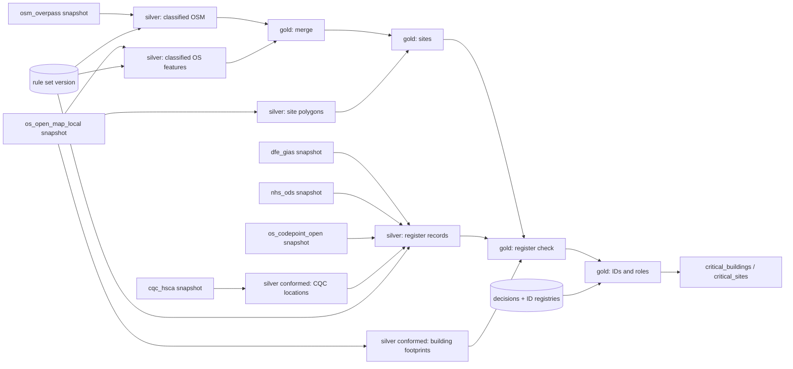

# Lineage

Where every value came from, at three levels.

## 1. Run lineage: `lineage.json`

Written into every run folder and copied into every release.

| Section | Contains |
|---|---|
| `run_id`, `area`, `run_type`, times, `tool_version` | which run |
| `git` | commit hash of the code and whether `src/` or `config/` had uncommitted changes (`dirty`) |
| `rules` | rule set version id and label (`v3-a1b2c3`) |
| `config` | hash of `config/pipeline.yml` and of the area file |
| `bronze` | for every source: snapshot, retrieval time, licence, each file with SHA-256 and size |
| `silver` | the silver build key and whether it was reused |
| `gold` | building and site counts, counts by source and verification, new IDs, previous run id, changes versus previous |
| `outputs` | every delivered file with SHA-256, plus a canonical content hash of the buildings table |

The canonical hash ignores columns that change on every run (dates, rule version) and row order, so two runs of
identical inputs have the same hash.

## 2. Dataset lineage

## 3. Record and column lineage

Inside the data itself:

| Column | Tells you |
|---|---|
| `Source`, `Source Feature ID` | which dataset(s) the record came from and the exact feature ids (OS GUID, OSM `way/123`, `CQC:1-...`, `DfE GIAS:123456`) |
| `Match Method`, `Confidence`, `Review Reason` | how OS and OSM were matched and any doubt |
| `OS Rule Ref`, `OSM Rule Ref`, `All Matched Rule Refs`, `Rule Notes` | which rules fired |
| `Classification Note` | if a register changed the type chosen from OS/OSM |
| `Site ID`, `Site Method` | which site and how it was formed |
| `Building Role Reason` | why a building is Primary or Ancillary |
| `Verification`, `Verification Note`, `Authoritative ID`, `Authoritative Distance (m)` | which register record confirmed it and how far apart |
| `Review Decision`, `Manual Override Notes`, `*Override` | human decisions |
| `Rule Version`, `Run Date` | the rule version and date of the run |

The data dictionary (`critical_buildings_data_dictionary.xlsx`) describes every column.

## Answering "why is this building like this?"

1. Find the record by `Building ID`. Read `Source Feature ID`, `Match Method`, `All Matched Rule Refs`.
2. `Rule Version` -> the rule set that classified it (UI, *Versions & history*, or `control/dumps/rule_tag.csv` in git history).
3. The run's `lineage.json` -> the exact input files.
4. Overrides: `control/dumps/override.csv` and the audit trail show any manual decision, who made it and why.
